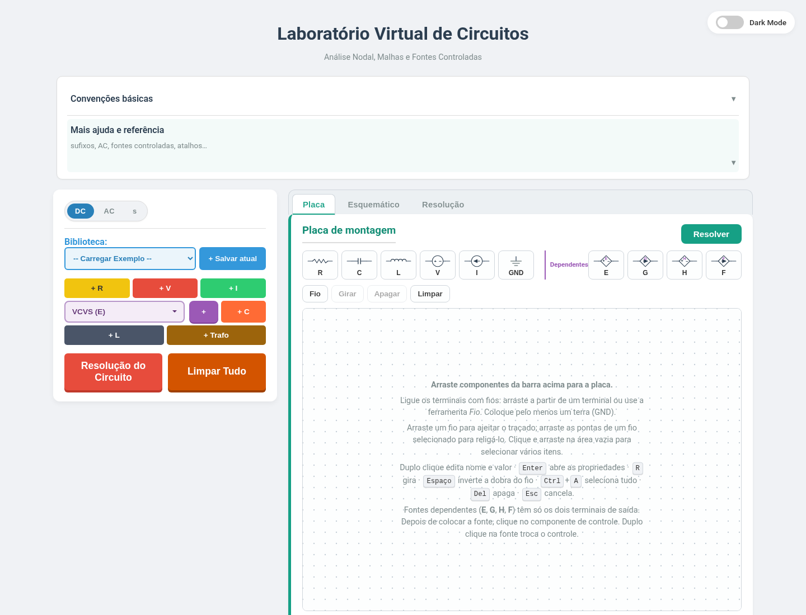
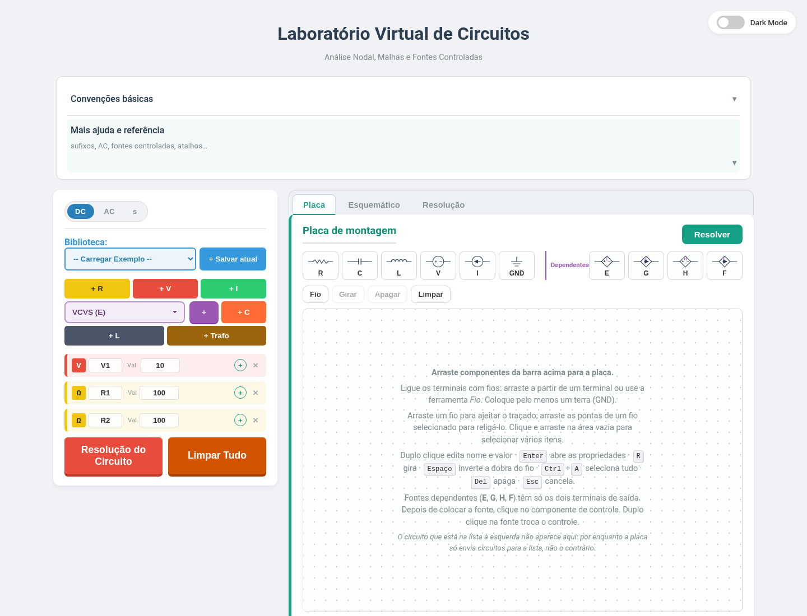
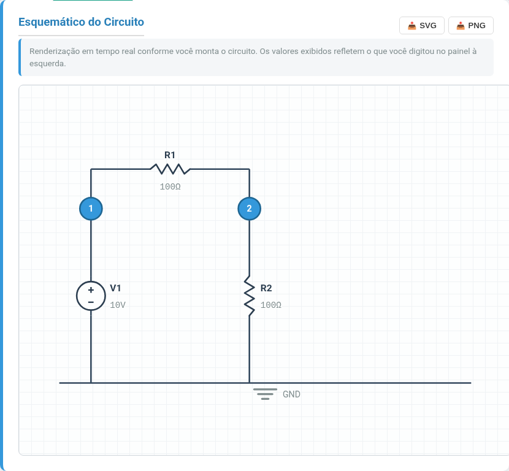
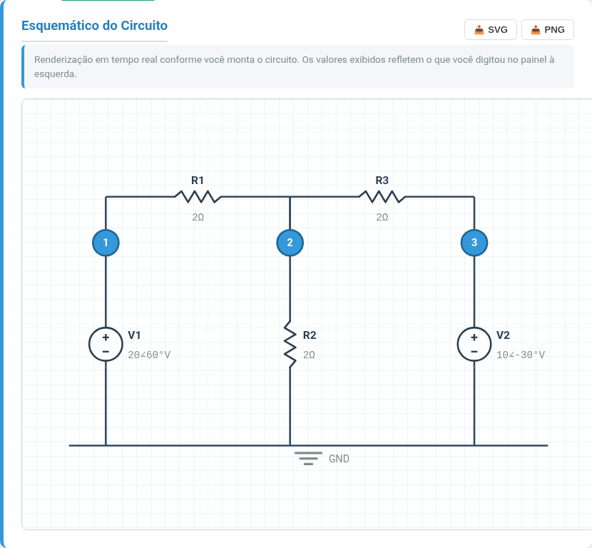
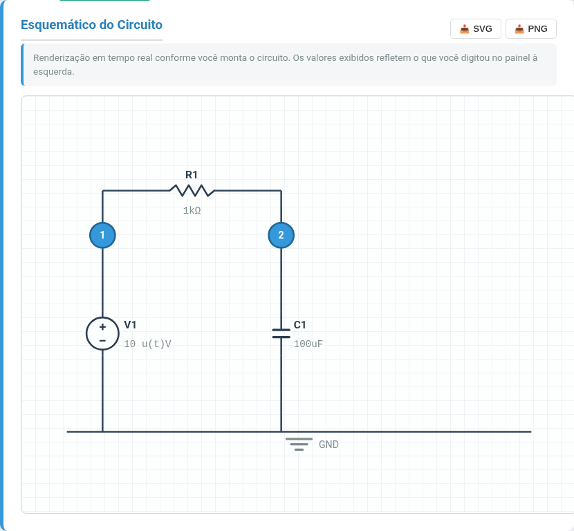

# Laboratório Virtual de Circuitos

**Site:** [https://herzeg9.github.io/Simulador-Circuitos-PUB/](https://herzeg9.github.io/Simulador-Circuitos-PUB/)

Laboratório virtual didático para circuitos elétricos concentrados. O aluno monta o circuito no navegador e recebe tensões, correntes e as equações da análise nodal modificada (MNA). A interface é um site estático no GitHub Pages; a resolução roda numa API na Wolfram Cloud, nos modos DC, AC (regime senoidal permanente, com fasores) e domínio *s* (Laplace).

Iniciação Científica com bolsa PUB-USP na Escola Politécnica da Universidade de São Paulo, Departamento de Engenharia de Energia e Automação Elétricas (PEA), de setembro de 2025 a agosto de 2026. Autor: Henrique Herzeg Penzo. Orientadora: Profa. Dra. Milana Lima dos Santos.

> **English.** Browser-based virtual lab for lumped electric circuits. A static site sends a JSON netlist to a Wolfram Cloud API that solves the circuit by modified nodal analysis (MNA) in DC, AC (sinusoidal steady state) and the Laplace *s*-domain. Undergraduate research (PUB scholarship) at the Escola Politécnica, University of São Paulo (PEA), by Henrique Herzeg Penzo, advised by Prof. Milana Lima dos Santos. Live site: https://herzeg9.github.io/Simulador-Circuitos-PUB/

## Capturas da interface

Visão geral do site: modos DC / AC / *s*, biblioteca de exemplos, lista de componentes e placa de montagem.



Exemplo em DC (divisor de tensão 10 V, R1 = R2 = 100 Ω), com a netlist à esquerda. O esquemático correspondente aparece na aba Esquemático.





Exemplo em AC a 60 Hz, com duas fontes senoidais (20 V ∠ 60° e 10 V ∠ −30°).



Exemplo no domínio *s*: RC com fonte em degrau de 10 V, R = 1 kΩ, C = 100 µF e *v*(0) = 0.



## Funcionalidades

- Três modos de análise:
  - **DC**
  - **AC**, em regime senoidal permanente, com fasores
  - **Domínio *s*** (Laplace), com aritmética racional exata, resposta no tempo \(v(t)\)/\(i(t)\), determinante \(\Delta(s)\), polos (frequências naturais) e resolução passo a passo; aceita condições iniciais e amplitudes simbólicas
- Placa no navegador com resistor, indutor, capacitor, fontes independentes de tensão e corrente, as quatro fontes controladas (VCVS, VCCS, CCVS e CCCS) e o transformador ideal
- Esquemático gerado a partir da netlist, resultados com MathJax, diagramas fasoriais e formas de onda
- Biblioteca de exemplos (divisor, ponte, fontes controladas, transformador, RC e RL no domínio *s*)

## Arquitetura

O site (HTML, CSS, JavaScript e SVG) monta a netlist a partir da placa ou da lista de componentes e envia um `POST` para um único objeto `APIFunction` na Wolfram Cloud, publicado na conta do autor. A API devolve JSON; o front-end formata equações, fasores e gráficos.

```text
navegador (GitHub Pages)
    → JSON da netlist (campo POST `netlist`)
    → API na Wolfram Cloud (conta herzeghenrique)
    → JSON com resultados, equações e, no modo s, Δ(s), polos e v(t)/i(t)
    → exibição no site (MathJax, gráficos)
```

No desenho atual, todos os usuários do site compartilham essa mesma API. Não é criada uma nuvem por aluno. O endpoint no código (`script.js`) é:

`https://www.wolframcloud.com/obj/herzeghenrique/simulador-circuitos-api-v2`

O `fetch` do site não envia login nem token. A publicação da API usa `CloudDeploy` com `Permissions -> "Public"`. Quem quiser uma cópia na própria conta precisa de um Wolfram ID e de um plano na Wolfram Cloud (veja abaixo).

O contrato do modo *s* está em [`wolfram/CONTRATO-S.md`](wolfram/CONTRATO-S.md). O programa da API no repositório está em `wolfram/simulador-circuitos-api-v2.wl` e no notebook `wolfram/simulador-circuitos-api-v2.nb`. A versão em produção é a v7 (DC, AC e domínio *s*).

O site é publicado pelo fluxo [`.github/workflows/deploy-pages.yml`](.github/workflows/deploy-pages.yml), a cada push na `main`.

## Como usar

1. Abra o [site](https://herzeg9.github.io/Simulador-Circuitos-PUB/).
2. Arraste os componentes para a placa (ou carregue um exemplo da biblioteca), ligue os terminais e escolha o modo (DC, AC ou *s*).
3. Clique em **Resolver** (ou em **Resolução do Circuito**).

Para rodar o site localmente, clone o repositório e abra `index.html` no navegador, ou sirva a pasta com qualquer servidor estático:

```bash
git clone https://github.com/herzeg9/Simulador-Circuitos-PUB.git
cd Simulador-Circuitos-PUB
npx --yes serve .
```

A resolução continua dependendo da API na Wolfram Cloud, salvo se você apontar `API_URL` em `script.js` para uma cópia sua.

## Como publicar uma cópia da API na sua conta

Isso é opcional. O caminho usual para o aluno é só usar o site.

1. Crie um [Wolfram ID](https://account.wolfram.com/) e entre na [Wolfram Cloud](https://www.wolframcloud.com/).
2. É preciso de um plano de nuvem:
   - O plano gratuito **Cloud Basic** permite publicar um `APIFunction` com `Permissions -> "Public"`, mas cada arquivo, deployment e API expira em 60 dias, há 5.000 Cloud Credits por mês, e o plano não se destina a uso institucional (aula ou pesquisa em grupo). Ver [restrições do Cloud Basic](https://support.wolfram.com/53990).
   - Planos pagos ou acesso acadêmico (por exemplo via [site license](https://www.wolfram.com/siteinfo/) da instituição, Wolfram|One ou Mathematica Online) mantêm os objetos sem essa expiração de 60 dias e incluem uma cota maior de créditos.
3. Abra o notebook da API (no repositório: `wolfram/simulador-circuitos-api-v2.nb`; a versão de trabalho atual é a v7). Avalie a célula de definições e, em seguida, a célula de testes. Só então avalie a célula de `CloudDeploy`, com `Permissions -> "Public"`. O passo a passo está em [`wolfram/NOTA-DEPLOY.md`](wolfram/NOTA-DEPLOY.md).
4. Se for usar essa cópia no site, troque `API_URL` em `script.js` pelo URL do seu `CloudObject`.

Cada chamada a uma API pública consome Cloud Credits da conta que a publicou (cerca de 1 crédito a cada 100 ms de cálculo). Se a cota acabar, é preciso esperar a renovação do período, comprar créditos extras ou mudar de plano; a API deixa de atender as requisições até haver créditos de novo.

Depois de editar o `.wl`, o notebook do repositório pode ser regenerado com:

```bash
python3 wolfram/build_nb.py
```

## Testes

Os scripts abaixo estão no `package.json`. A maior parte roda só com Node. Os testes visuais (`test:visual`) usam Puppeteer, `pngjs` e `pixelmatch` e pedem `npm install`.

```bash
npm install
npm test
```

`npm test` encadeia, nesta ordem:

| Script | O que roda |
|---|---|
| `npm run test:placa` | `tests/placa-netlist.mjs` |
| `npm run test:formato` | `tests/formato-resultado.mjs` |
| `npm run test:s` | `tests/s-dominio.mjs` |
| `npm run test:sentido` | `tests/sentido-fonte.mjs` |
| `npm run test:esquematico` | `tests/esquematico-audit.mjs` |
| `npm run test:svg` | `tests/svg-snapshot.mjs` |
| `npm run test:visual` | `tests/visual-esquematico.mjs` |

No GitHub Actions, o fluxo [`.github/workflows/test-esquematico.yml`](.github/workflows/test-esquematico.yml) roda a auditoria do esquemático, os snapshots SVG e a regressão visual em todo push e pull request na `main`.

Há também testes locais da API em `wolfram/testes-locais.wl` e na célula de testes do notebook.

## Validação

Nos ensaios em DC (circuitos RC/RL e VCVS), o erro relativo frente aos valores analíticos foi de 0,00%. O modo AC foi validado a 60 Hz.

## Autores e afiliação

- **Henrique Herzeg Penzo** — Engenharia Elétrica, Escola Politécnica da USP. [LinkedIn](https://www.linkedin.com/in/henrique-herzeg-penzo)
- **Orientadora:** Profa. Dra. Milana Lima dos Santos — Departamento de Engenharia de Energia e Automação Elétricas (PEA), Escola Politécnica da USP

Bolsa do Programa Unificado de Bolsas (PUB) da Universidade de São Paulo, setembro de 2025 a agosto de 2026 (o prazo do relatório final é fevereiro de 2027).

Entregas do projeto: relatório semestral (setembro de 2026); resumo e vídeo submetidos ao SIICUSP; pôster 70×100 cm apresentado com arguição; apresentação do trabalho com a orientadora num evento da Wolfram em 7 de novembro de 2026.

## Tecnologias

Wolfram Language, Wolfram Cloud, JavaScript, HTML, CSS, SVG, MathJax, JSON, GitHub Pages e GitHub Actions.

## Licença

Este repositório ainda não tem um arquivo `LICENSE`. Falta escolher e registrar uma licença antes de tratar o projeto como redistribuível (por exemplo, uma licença de código aberto para o site e outra, se for o caso, para o notebook). Enquanto isso não for definido, o uso deve seguir o que os autores autorizarem.
